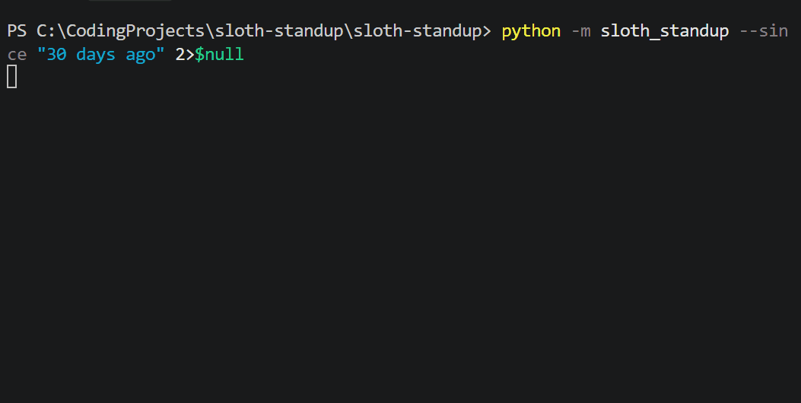

# sloth-standup

A lazy, fully local git standup bot. It reads your commits, uncommitted work
and open PRs, then an open-weight model running inside Python writes a
two-line standup. No Ollama, no server, no API key, no data leaving your laptop.



## Setup

```bash
pip install -r requirements.txt
copy config.example.json config.json      # then edit your repo paths
python -m sloth_standup --dry-run         # check what the model will see
python -m sloth_standup                   # first run downloads ~1 GB, once
```

If `pip install llama-cpp-python` tries to compile and fails on Windows, use the
prebuilt CPU wheels:

```bash
pip install llama-cpp-python --extra-index-url https://abetlen.github.io/llama-cpp-python/whl/cpu
```

Already have a GGUF file? Set `"model_path": "C:/models/your-model.gguf"` in
`config.json` instead of `model_repo`/`model_file`.

## Make it lazy (Windows)

```bat
schtasks /Create /SC DAILY /TN "SlothStandup" /TR "\"%cd%\run_standup.bat\"" /ST 08:30
```

Your standup lands in `standups/YYYY-MM-DD.md` every morning.

## Options

```
python -m sloth_standup --since "2 days ago" --repo C:/path/to/repo --author Aaru
```

Monday automatically looks back to Friday. `gh` (GitHub CLI), if installed,
adds your open PRs.

## Why open

- Private diffs and unreleased code never touch a hosted API.
- Zero per-run cost, so it can run every day forever.
- Works offline after the one-time model download.
- Swap the model by changing one line of config.
